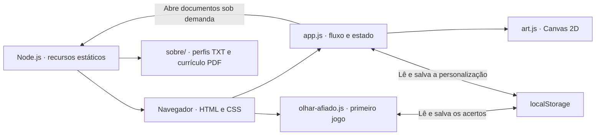

# Front Arcade

O Front Arcade é um acervo de minijogos sobre boas práticas de front-end, criado para a etapa prática do minicurso de Enzo Maia e Pedro Paulo na Semana Acadêmica da UFS. A proposta é experimentar como as escolhas de design e implementação de um site afetam a experiência de quem o usa.

As atividades são pensadas tanto para quem já programa quanto para participantes de outras áreas. Dá para aprender jogando, mesmo sem experiência com programação.

## Primeiro dia — Palestra

A palestra usa demonstrações ao vivo para mostrar como decisões de interface (UI) influenciam a experiência de uso (UX), da escolha do tamanho de um botão à forma como o navegador renderiza a página.

- **Leis da usabilidade** — como o tamanho e a posição de um alvo afetam o clique, como a quantidade de opções influencia o tempo de decisão e como os hábitos e a memória afetam a navegação.
- **Sistemas visuais** — como espaçamentos em múltiplos de 8, linhas de texto com comprimento confortável e cores com função definida ajudam a organizar a informação.
- **Os cinco estados da interface** — como projetar a tela no cenário ideal, durante o carregamento, quando está vazia, quando ocorre um erro e quando aparece um caso fora do fluxo habitual.
- **Movimento na interface** — como animações e transições podem ajudar a acompanhar mudanças na tela.
- **Engenharia de front-end** — como a renderização pelo navegador, a composição acelerada pela GPU, a estabilidade visual e o HTML semântico afetam o desempenho e a acessibilidade.

## Segundo dia — Oficina prática

Os minijogos retomam os temas da palestra em desafios interativos. A ideia é que cada participante experimente situações comuns em sites, compare como diferentes decisões de interface afetam uma tarefa e perceba o que facilita ações como encontrar uma opção, clicar no lugar certo ou entender o que aconteceu depois de uma falha.

## Visão técnica

O Front Arcade é uma aplicação web que simula uma área de trabalho retrô. A versão atual inclui o editor de avatares, a pasta **Sobre Nós**, dois jogos e o aplicativo independente **Construa Meu Site**.

| Camada | Responsabilidade |
| --- | --- |
| [HTML](index.html) e [CSS](styles.css) | Interface responsiva, diálogos nativos, estados de foco e transição de inicialização. |
| [JavaScript](app.js) | Orquestração do desktop, abertura de janelas, personalização, validação e persistência do perfil. |
| [Canvas 2D](art.js) | Composição em camadas da arte em pixels, incluindo avatares, fantasias, itens, cenários, miniaturas e retratos dos autores. |
| [Olhar Afiado](olhar-afiado.js) | Roda de cores em Canvas, seleção em HSL, comparação perceptual em OKLab e progresso local. |
| [Os Pop-ups Infinitos](popups-infinitos.js) | Formulário de quatro etapas, contagem regressiva, avisos concorrentes e registro de conclusão. |
| [Lag Lab](lag-lab.js) | Fila de eventos com latência artificial e comparação de contornos em Canvas. |
| [Construa Meu Site](site-builder.js) | Composição de páginas por recortes editáveis. O mesmo renderizador monta a prévia e o HTML exportado. |
| [Node.js](server.js) | Servidor HTTP local baseado na biblioteca padrão, com mapeamento explícito de arquivos estáticos e seus tipos MIME. |

- **Produto.** A primeira entrega prioriza a entrada na oficina e a experimentação imediata, inclusive para quem nunca programou. A criação guiada na primeira visita e a recuperação do avatar são comportamentos verificáveis no navegador.
- **Progressão na coletânea.** Olhar Afiado exige pelo menos 85% de semelhança para contar um acerto. O jogador pode escolher livremente as imagens do acervo e trocar de desafio mantendo os acertos já conquistados. Dez imagens distintas acertadas desbloqueiam o próximo jogo. O acervo marca as imagens já acertadas, que podem ser revisitadas.
- **Contexto antes de jogar.** Olhar Afiado relaciona a percepção de cor à consistência da interface e ao contraste. Os Pop-ups Infinitos apresentam fricção, escolha de controles e prevenção de erros antes do desafio.
- **Latência percebida.** Lag Lab fica disponível após a conclusão de Os Pop-ups Infinitos. A mesma referência é reproduzida com 0, 100, 400 e 1000 ms de atraso. A pontuação combina cobertura do modelo e precisão dos traços, com tolerância de oito pixels lógicos no contorno.
- **Construtor de sites.** O scrapbook combina recortes prontos, fotos do dispositivo e adesivos ilustrados. É possível ajustar tamanho, posição e bordas, escolher a identidade visual e testar a largura de celular. O rascunho é salvo no navegador, e a exportação gera um HTML independente com as imagens e os [estilos da prévia](site-preview.css) incorporados.
- **Tela cheia.** A janela Jogos e o construtor oferecem tela cheia nativa. Onde o navegador restringe esse recurso, a janela ocupa a área visível do Front Arcade.
- **Fricção no formulário.** A rodada usa uma ficha fictícia e dura 40 segundos. Avisos com fotos da LAWD interrompem o fluxo, e um dos anúncios dispara um alerta simulado após o clique. O alerta orienta a verificar a origem de pop-ups e oferece o reinício do Front Arcade, com as conquistas preservadas no armazenamento local.
- **Configuração de desafios.** Cada fase de Olhar Afiado define a descrição da região, a cor de referência e o ponto indicado em coordenadas de 320 × 240. O acervo reúne 46 desafios. As ilustrações 2D são renderizadas em Canvas. O [wallpaper da LAWD](assets/lawd-wallpaper.png) é pixelizado no navegador e recebe uma máscara que restringe a recoloração ao símbolo. Para outras imagens, os campos opcionais `image` e `mask` aceitam arquivos servidos localmente.
- **Identidade regional.** O acervo traz ilustrações do campus de São Cristóvão, do DCOMP e da Biblioteca Central da UFS, além de cartões-postais de Aracaju. [Departamento de Computação da UFS](https://admin.dcomp.ufs.br/faleconosco) · [Sistema de Bibliotecas da UFS](https://bibliotecas.ufs.br/pagina/6339) · [Guia turístico da Prefeitura de Aracaju](https://www.aracaju.se.gov.br/userfiles/pdf/2021/docs/FOLDER_VENHA_SENTIR_ARACAJU.pdf)
- **Compatibilidade.** O perfil usa a chave versionada `front-arcade.avatar.v1`. A leitura valida os valores salvos e completa as opções ausentes com padrões, permitindo abrir perfis criados antes da adição de novas categorias.
- **Acessibilidade e animação.** Os controles são navegáveis pelo teclado. A inicialização e a prévia respeitam a preferência de movimento reduzido. A animação do avatar é interrompida quando o editor fecha ou a página deixa de estar visível.
- **Conteúdo separado da interface.** Os documentos [Enzo.txt](sobre/Enzo.txt) e [PP.txt](sobre/PP.txt) são carregados sob demanda e renderizados como texto. A ficha de Enzo oferece um retrato em pixel art e o [currículo original em PDF](sobre/Curriculo-Enzo-Costa.pdf) para download.

Com o Node.js instalado, rode `npm run dev` na raiz do repositório e abra [localhost:3000](http://localhost:3000). A pasta **Sobre Nós** fica abaixo de **Jogos**. Se for a primeira visita, feche ou salve o editor de avatar para acessá-la.
