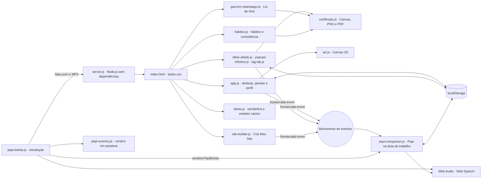

# Front Arcade

O Front Arcade é um acervo de minijogos sobre boas práticas de front-end, criado para a etapa prática do minicurso de Enzo Maia e Pedro Paulo na Semana Acadêmica da UFS. A proposta é experimentar como as escolhas de design e implementação de um site afetam a experiência de quem o usa.

As atividades são pensadas tanto para quem já programa quanto para participantes de outras áreas. Dá para aprender jogando, mesmo sem experiência com programação.

## Primeiro dia — Palestra

A palestra usa demonstrações ao vivo para mostrar como decisões de interface (UI) influenciam a experiência de uso (UX), da escolha do tamanho de um botão à forma como o navegador renderiza a página.

- **Leis da usabilidade** — como o tamanho e a posição de um alvo afetam o clique, como a quantidade de opções influencia o tempo de decisão e como os hábitos e a memória afetam a navegação.
- **Sistemas visuais** — como espaçamentos em múltiplos de 8, linhas de texto com comprimento confortável e cores com função definida ajudam a organizar a informação.
- **Os cinco estados da interface** — como projetar a tela no cenário ideal, durante o carregamento, quando está vazia, quando ocorre um erro e quando aparece um caso fora do fluxo habitual.
- **Movimento na interface** — como animações e transições podem ajudar a acompanhar mudanças na tela.
- **Engenharia de front-end** — como a renderização pelo navegador, a composição acelerada pela GPU, a estabilidade visual e o HTML semântico afetam o desempenho e a acessibilidade.

## Segundo dia — Oficina prática

Os minijogos retomam os temas da palestra em desafios interativos. A ideia é que cada participante experimente situações comuns em sites, compare como diferentes decisões de interface afetam uma tarefa e perceba o que facilita ações como encontrar uma opção, clicar no lugar certo ou entender o que aconteceu depois de uma falha.

## Introdução com o Pepi Bolota

Na tela inicial, o botão **Pedir introdução**, abaixo de **Começar**, chama o Pepi Bolota, o robô guia do Front Arcade. A introdução apresenta a oficina antes de qualquer jogo, para quem nunca programou e para quem já programa:

1. **Chegada.** A tela liga como um monitor antigo, na oficina do Pepi: uma sala em planta-baixa, com piso quadriculado em perspectiva e bits de dados flutuando. Uma janela `pepi_bolota.exe` desenha a planta do Pepi e o imprime linha por linha enquanto o log lista cada peça. Pronto, ele abre a oficina para o mundo: um círculo cresce a partir dele e revela a Orla de Atalaia, em Aracaju, enquanto ele olha em volta, encantado. Então vira bola, rola até a tela, se abre e bate no vidro até trincá-lo: as rachaduras partem do ponto do impacto, se ramificam e formam uma teia, lascas de vidro caem e, um instante depois, algumas trincas ainda avançam um pouco. Ele volta rolando, meio sem graça.
2. **Apresentação.** Diz quem é, que foi criado pelos dois "pais adotivos" para a Semana Acadêmica da Universidade Federal de Sergipe e que foi feito com muito amor para ser o guia deste sistema operacional e do acervo de jogos.
3. **A oficina.** Explica o que é front-end, o objetivo do laboratório e os temas da palestra: usabilidade, cores e espaçamentos, telas de carregamento e de erro, animações e desempenho. Em seguida apresenta cada minijogo e o **Construa Meu Site**, e lembra que não é preciso saber programar.
4. **Os papais.** Chama os apresentadores, olhando para a esquerda da tela, leva um susto e fica com interrogações na cabeça. Então se vira para o público e dá uma risadinha. Depois olha para a direita e chama as versões em pixel de Enzo e PP, que entram por esse lado.
5. **Encerramento.** Agradece a participação na oficina e indica o botão **Começar**. Ao clicar, ele pede para conhecer o jogador e vira bola no centro da tela. Em vez da tela de inicialização de sempre, a área de trabalho já liga por baixo e a cena se fecha em íris sobre a bolinha, o mesmo círculo que abriu a orla. A bolinha dá um quique e some, deixando uma estrelinha sobre a área de trabalho. Ele reaparece no editor de avatar, inclinado e espiando pela borda direita da tela. Ele acena, fala num balão sobre a cabeça e depois fica por perto (se houver espaço ao lado do editor): os olhos seguem o mouse, comemora cada escolha, cumprimenta o nome digitado ("Prazer, Ana!") e ri quando o cursor passa sobre ele.

**Cenário.** O fundo é pixel art de dia, em três camadas com paralaxe ([pepi-scenery.js](pepi-scenery.js)): a Orla de Atalaia com o mar, os quatro arcos azuis revestidos de pastilhas (os dois do meio mais altos, como os de verdade), coqueiros, gaivotas e a estátua do caranguejo gigante; quando o Pepi fala da Semana Acadêmica, a câmera viaja até o campus da UFS, com o prédio da UFS, o prédio da SEMAC e ipês floridos. O Pepi e a dupla têm uma borda branca em pixel, como um adesivo, para se destacarem do cenário. Dois cartões pequenos mostram o humor e o local do Pepi, atualizados ao vivo, e um medidor `voz.wav` reage ao volume da fala gravada.

**Destaque.** Em momentos escolhidos (o "olá", o "feito com amor", o "E a melhor parte: eu!" e a risadinha) a câmera aproxima o Pepi no centro e um foco escurece o resto da tela. No encerramento ele volta ao tamanho normal, um pouco menor que as versões em pixel dos apresentadores.

O Pepi é alegre na maior parte do tempo, mas também demonstra emoção. Tem treze expressões (normal, feliz, apaixonado, "ops", surpreso, em dúvida, rindo, piscadinha, olhos de estrela, tímido, preocupado, dormindo e desconfiado, de olhos semicerrados), sobrancelhas móveis, bochechas que coram, gota de suor, coração que acelera e gestos como acenar, comemorar, fazer reverência e levar a mão ao rosto ao rir. Algumas reações acontecem na palavra exata da fala gravada, como a piscadinha em "eu!" e os olhos de estrela em "Isso não é animal?".

**Voz.** As falas ficam em `lines`, no [pepi-bolota.js](pepi-bolota.js), e cada uma tem uma chave. Gravações em MP3 colocadas em [assets/pepi/](assets/pepi/) e listadas em [falas.json](assets/pepi/falas.json), como `{ "hello": "01-hello.mp3" }`, têm prioridade sobre a voz sintetizada. Enquanto uma gravação toca, a boca do robô abre e fecha conforme o volume do áudio. Falas sem gravação usam a voz sintetizada do navegador, de preferência uma voz masculina em português, como a Daniel do Windows, com o tom mais agudo para soar infantil.

**Acessibilidade.** As falas aparecem em legendas e são anunciadas para leitores de tela. A cena tem botões para desligar o som e para pular, e o Esc também a encerra. Com movimento reduzido ativado, a rolagem, o voo e o tremor da tela são suprimidos.

## O Pepi na área de trabalho

Depois que o avatar é salvo, o Pepi chega rolando e passa a morar em cima da barra de tarefas ([pepi-companion.js](pepi-companion.js)). Ele se apaixona pelo avatar novo ("Caramba, então você é assim?"), aponta para o ícone **Jogos**, que brilha, e depois passeia pela barra. Para se mover ele se transforma em bola: a tela do rosto apaga, antena, braços, orelhas e pés se recolhem, ele rola até o destino e se desdobra de novo. Parado, se espreguiça, olha em volta e acompanha o mouse com os olhos. Sem atividade por um tempo, ele chama para jogar e, depois, cochila soltando "z"; um clique ou o mouse por perto o acordam.

- **Sem atrapalhar.** Com uma janela aberta, ele fica no espaço livre ao lado dela. Sem espaço (ou em tela cheia), só a cabeça espia por trás da barra de tarefas. O balão fica sobre a cabeça dele, deixa os cliques passarem e fica transparente quando o mouse se aproxima.
- **Nos jogos.** Cada jogo avisa seus momentos pelo evento `frontarcade:event` (abrir, acertar, errar, vencer, perder). O Pepi apresenta cada jogo na primeira visita, comemora os acertos (com fala no primeiro e a cada três, e só com festa nos outros), consola depois de erros seguidos com um abraço, ri das pegadinhas dos pop-ups, aparece dentro do alerta de vírus e comenta o atraso no Lag Lab.
- **Dá para pegar o Pepi.** Arrastado, ele fica pendurado no ponto em que foi pego e balança com o movimento do mouse, de olhos semicerrados e sobrancelha levantada, desconfiado. Pego pelos pés, ele vira de cabeça para baixo e entra em pânico. Ao ser solto, cai de volta na barra: de pé ele amortece a queda (e fica tonto se ela for alta); de cabeça para baixo ele fica plantando bananeira, chuta os pés e se desvira com um pulinho.
- **Alerta de vírus.** Quando o vírus "se instala" nos Pop-ups Infinitos, o Pepi entra rolando no alerta em modo de emergência: sirene vermelha na antena, placa de perigo e tremedeira. Ele explica que é preciso reiniciar, tranquiliza sobre as conquistas salvas e aponta para **Reiniciar Front Arcade**, que fica pulsando.
- **Voo com propulsores.** De vez em quando, com a área de trabalho vazia, o Pepi agacha, acende dois propulsores em pixel embaixo dos pés e sai voando livremente pela tela: faz uma rota em curva, inclina o corpo nas curvas, às vezes dá uma pirueta, solta fumacinha e pousa de leve na barra de tarefas, com o ronco do motor sintetizado no navegador. Dá para pegá-lo no meio do voo: os propulsores desligam e ele fica pendurado, desconfiado. Abrir um jogo ou uma janela faz ele pousar na hora.
- **Apaixonado.** Três minutos depois de o Pepi chegar, nasce uma florzinha no chão da área de trabalho. Clicando nela, ele vai colher; se ninguém clicar, ele colhe sozinho depois de um tempo. Ele olha para os lados, esconde a flor nas costas e pega o celular: rola as fotos, suspira e conta que está apaixonado pela Brem Daya 2.0, uma robozinha lilás e menta, com laço rosa, antena de coração e "2.0" no peito. Então pergunta ao jogador se deve chamá-la para sair, com os botões **Sim, chama ela!** e **Agora não** no próprio balão. No sim, ele fica nervoso, suando, se enrola todo no convite e põe as mãos no rosto achando que estragou tudo. Mas um coraçãozinho cai do céu como estrela cadente, pousa ao lado dele com um anel de luz, e um feixe rosa desce sobre o ponto: um holograma da Brem pisca, o scanner a imprime de cima para baixo enquanto ela flutua, e ela pousa, dá um giro e faz pose com uma piscadinha. A flor que ele tinha escondido aparece na mão dele e flutua até as mãos dela; ela aceita, ele comemora e ela se despede voltando pelo feixe. No não, ele guarda o celular e diz que vai esperar o momento certo. Uma nova flor nasce três minutos depois. Para testar sem esperar, abra o endereço com `?flor` (por exemplo, `localhost:3000/?flor`): a flor nasce cinco segundos depois de o Pepi chegar. Qualquer jogo ou janela aberta interrompe a cena na hora. Se a flor nascer com a janela de jogos aberta, ela brota ao lado do Pepi, brilhando, e ele pede ajuda ao jogador para colhê-la; com um clique, ele a colhe, agradece e guarda a flor até a área de trabalho ficar livre, quando a cena com a Brem começa.
- **Jogos individuais e em grupo.** Ao abrir **Jogos**, o jogador escolhe entre **Individual** (seis jogos, com o progresso à vista) e **Duo e grupo** (desafios para jogar com amigos, a caminho). Os dois cards são retratos: o Individual mostra o avatar do próprio jogador, e o Duo e grupo, uma pilha de três rostos sorteados com as peças do editor de avatar, com selos de fliperama "1P" e "2P+". O Pepi avisa: concluindo todos os jogos individuais, vem um prêmio surpresa. Cada jogo tem um emblema em pixel art (o mesmo desenhado no certificado), com um selo de cadeado enquanto espera o jogo anterior e um ✓ depois de concluído. Os jogos abrem em sequência: cada um só libera depois que o anterior é concluído.
- **Garçom Relâmpago.** No quarto jogo individual, liberado depois do Lag Lab, o Pepi vira garçom a caráter: colete preto com botões dourados, camisa, gravata-borboleta vermelha, avental, pano no braço, bigode e bandeja. Os pedidos chegam das mesas e o jogador acha cada item em cardápios de 4, 8, 16 e 32 salgados, doces, bebidas e sabores de Sergipe, embaralhados a cada pedido. Cada mesa espera no máximo 7 segundos: a barra de paciência esvazia, o cliente fica impaciente e, se o tempo acabar, vai embora e o jogo mostra qual era o item. O Pepi leva o prato até a mesa a cada acerto. Depois vem uma rodada com as mesmas 32 opções e filtros por categoria. No fim, um gráfico mostra o tempo médio de cada cardápio contra o limite de espera, a curva da Lei de Hick ajustada aos tempos do próprio jogador e quanto os filtros aceleraram a escolha. Servir pelo menos 12 dos 20 pedidos a tempo conclui o turno e libera o próximo jogo. Para testar sem jogar os anteriores, abra o endereço com `?garcom`.
- **Armadilha dos Hábitos Ruins.** O quinto jogo individual, liberado depois do Garçom Relâmpago, num painel de inscrições de mentira. A tarefa é sempre a mesma: abrir o pedido novo da fila e clicar em **Aprovar**, 8, 10 ou 12 vezes, com um limite de tempo que encolhe de 6,5 s para 2,4 s. Depois de três pedidos para criar o hábito, dois em cada três escondem uma armadilha, e o caos cresce em três níveis. No nível 1 muda uma coisa só: Aprovar e Recusar trocam de lugar, as cores se invertem, o botão verde passa a dizer Recusar, surgem botões novos (um deles no lugar do Aprovar), a barra de ações sobe para o topo ou um pedido urgente fura a fila. No nível 2 vêm duas mudanças juntas, ou o Aprovar some dentro de um menu **Mais ações** enquanto um "Salvar rascunho" verde ocupa o lugar dele. No nível 3 vêm três ou quatro de uma vez, com até seis botões, a janela tremendo e os botões mudando de lugar de novo, animados, no instante em que o jogador mira. Quem erra vê onde o Aprovar estava. Responder pelo menos metade dos pedidos dentro do tempo conclui o jogo. No fim, o jogo mostra quando o hábito se formou, o erro sem mudança comparado ao erro depois da mudança (também por nível de caos), um gráfico do tempo de cada pedido contra o limite e o resultado de cada armadilha. Para testar direto, abra o endereço com `?habitos`.
- **Tela em Obras.** O sexto jogo individual, liberado depois da Armadilha dos Hábitos Ruins, junta HTML semântico e estados vazios. O Pepi vira mestre de obras, de capacete, colete refletivo e prancheta. Em três obras com tempo cada vez menor (90, 75 e 60 s), o jogador monta o estado vazio de uma caixa de entrada, de um carrinho e de uma busca sem resultado. Ele encaixa blocos coloridos como peças de Lego, cada um com a tag que representa (`<h2>`, ``, `<button>`, `<label>` + `<input>`), arrastando com o mouse ou o dedo ou clicando, e reordena com as setas. Algumas peças são armadilhas: título que pula níveis, `<p>` em negrito fingindo ser título, `<div>` clicável, imagem sem descrição, placeholder no lugar de rótulo e textos frios ou que culpam a pessoa. A auditoria dá uma nota em % com oito checagens, quatro de semântica (hierarquia de títulos, rótulos, descrições, ordem de foco) e quatro de estado vazio (explica o porquê, indica a ação, tom amigável, hierarquia visual), e mostra lado a lado como a tela fica e o que o leitor de tela anuncia. Uma média de 60% conclui o jogo. Para testar direto, abra o endereço com `?obras`.
- **Certificado.** O prêmio surpresa fica embrulhado na lista individual até o último jogo ser concluído. Na primeira vez em que aparece liberado, a caixa se abre na medalha e o Pepi anuncia o **Certificado do Front Arcade**. O certificado traz o nome e o avatar do jogador, os jogos com a habilidade que cada um treina, o selo do Pepi, a data de emissão e um código de verificação, e pode ser baixado em PNG ou em PDF A4. Para ver sem concluir os jogos, abra o endereço com `?certificado`.
- **Controles.** O ícone do Pepi na barra de tarefas abre um menu para tirá-lo da tela ou desligar a voz. As escolhas ficam salvas no navegador.
- **Falas.** Ficam em `lines`, no [pepi-companion.js](pepi-companion.js), e usam as gravações de `20-saved.mp3` a `73-waiter-retry.mp3`, listadas em [falas.json](assets/pepi/falas.json). Falas com `speaker: "brem"` são da Brem Daya 2.0: o balão troca o nome e a boca dela acompanha o áudio. Uma fala sem gravação aparece só como legenda; as que ainda faltam gravar estão listadas em [falas-para-gravar.md](assets/pepi/falas-para-gravar.md).

## Visão técnica

O Front Arcade é uma aplicação web que simula uma área de trabalho retrô. Inclui a introdução com o Pepi Bolota, o Pepi como companheiro na área de trabalho, o editor de avatares, a pasta **Sobre Nós**, três jogos e o aplicativo independente **Construa Meu Site**.

São cerca de 11 mil linhas de HTML, CSS e JavaScript, **sem framework, sem dependências e sem etapa de build**. Tudo o que aparece na tela é feito com APIs nativas do navegador: a arte em pixel é desenhada em código (Canvas 2D e SVG), os efeitos sonoros são sintetizados com a Web Audio API e as animações usam a Web Animations API. A escolha é proposital: o projeto mostra o que a plataforma web oferece sozinha e serve de material para uma oficina de front-end.

### Destaques de engenharia

- **Física em tempo real no navegador.** Arrastado, o Pepi se comporta como um pêndulo amortecido preso ao ponto em que foi pego. A cada quadro, a aceleração do ponteiro alimenta a equação `ψ'' = (aₓ·cos ψ − (g − a_y)·sin ψ) / L − c·ω`. Ao ser solto, ele entra em queda livre com gravidade, ricocheteia nas bordas e decide como pousar (de pé, tonto ou de cabeça para baixo) pela altura da queda e pelo ângulo do corpo. No voo com propulsores, a rota é uma spline Catmull-Rom por pontos sorteados, amostrada em uma polilinha com comprimento acumulado; uma busca binária posiciona o Pepi por distância percorrida, o que mantém a velocidade constante na curva, e a inclinação e a força das chamas saem da velocidade a cada quadro.
- **Linha do tempo cancelável.** A introdução é uma sequência de passos assíncronos (`move`, `say`, `knock`, `look`…), e todos escutam o mesmo `AbortSignal`. "Pular", Esc ou fechar o diálogo interrompem de uma vez a voz, os timers, as animações e o áudio, sem deixar estado pendurado.
- **Sincronia labial a partir do áudio.** Um `AnalyserNode` lê a forma de onda da fala que está tocando. O RMS de cada quadro abre ou fecha a boca do robô, com histerese de 70 ms para evitar tremulação, e alimenta o medidor `voz.wav`.
- **Comparação perceptual de cor.** O Olhar Afiado converte sRGB para o espaço OKLab (linearização gama e matrizes LMS) e mede a distância euclidiana entre a cor escolhida e a cor esperada. Assim, a pontuação acompanha a percepção humana, e não a diferença numérica entre valores RGB.
- **Lei de Hick medida no próprio jogador.** O Garçom Relâmpago cronometra cada pedido a partir do quadro em que o cardápio é pintado e ajusta, por mínimos quadrados, a curva `T = a + b·log₂(n + 1)` às médias dos quatro tamanhos de cardápio. Pedidos perdidos entram como dados censurados no limite de 7 s, para que a média não fique otimista justamente nos cardápios mais difíceis. Os clientes são sorteados com as mesmas peças do editor de avatar, desenhadas por `art.js`.
- **Curva de aprendizado medida no próprio jogador.** A Armadilha dos Hábitos Ruins ajusta a lei da prática, `T = a·n^−b`, por regressão nos logaritmos dos tempos dos pedidos sem armadilha. Ela considera o hábito formado no pedido em que a curva achata, quando uma repetição passa a economizar menos de 10% em relação à anterior. O gráfico é um SVG gerado no navegador, com mira vertical, dica por pedido e redesenho por `ResizeObserver`.
- **Pontuação de traço com transformada de distância.** O Lag Lab compara o desenho do jogador com o contorno de referência usando uma transformada de distância em duas passadas (chamfer) sobre a máscara de pixels. Isso permite uma tolerância de oito pixels sem comparar ponto a ponto.
- **Latência simulada de forma determinística.** No Lag Lab, os eventos de ponteiro entram numa fila com instante de entrega (`due`) e são liberados por um único timer. O jogador sente 0, 100, 400 e 1000 ms de atraso sem que a ordem dos eventos se perca.
- **Transformação de robô em bola.** Cada peça do SVG (rosto, antena, braços, orelhas e pés) tem a própria animação WAAPI, com easing por quadro-chave e escalonamento entre elas. As animações são rastreadas e canceladas por um token de viagem, de modo que uma nova ordem de movimento nunca briga com a anterior.
- **Transições com máscara animada.** A oficina se abre para a orla e a introdução se fecha sobre o Pepi com `mask: radial-gradient(...)`, cujo raio é uma propriedade customizada registrada com `@property` (`--hole` e `--iris`) e animada pela Web Animations API. Navegadores sem `@property` simplesmente pulam o efeito. Na saída, a área de trabalho é ligada por baixo do diálogo, com o `::backdrop` transparente, e aparece em volta do círculo que se fecha.
- **Convivência com a camada superior (top layer).** Quando o alerta de vírus abre como `<dialog>` modal, o Pepi é reposicionado para dentro do próprio diálogo, para continuar visível acima do backdrop. O menu dele usa a Popover API pelo mesmo motivo.
- **Arte procedural em pixel.** Os avatares são compostos em camadas no Canvas 2D (cabelo atrás, rosto, roupa, acessórios, cenário). As versões em pixel de Enzo e PP recebem troca de paleta pixel a pixel via `ImageData`. O Pepi e a Brem Daya 2.0 são desenhados retângulo por retângulo em SVG com `shape-rendering: crispEdges`. A Brem reaproveita os nomes de classe do rosto do Pepi, então as expressões, o piscar e a sincronia labial funcionam nela sem código novo.
- **Certificado gerado no navegador, com PDF escrito à mão.** O certificado é desenhado em Canvas 2D (2000 × 1414, a proporção do A4) com o avatar renderizado pelo mesmo `art.js` e o Pepi convertido de SVG inline em imagem, com as regras de rosto embutidas no próprio SVG. O PNG sai de `canvas.toBlob`. O PDF é montado byte a byte, sem biblioteca: catálogo, página A4 paisagem, o JPEG do canvas como XObject com filtro `DCTDecode` e a tabela `xref` com os deslocamentos calculados. O código de verificação é um hash FNV-1a do nome e da data de emissão, que fica salva para o certificado nunca mudar.
- **Rachadura procedural.** A trinca da introdução é gerada a cada vez: raios em passeio aleatório que afinam e se ramificam, anéis da teia ligando raios vizinhos, facetas que refletem a luz e lascas com trajetória parabólica. Cada segmento é desenhado com `stroke-dashoffset` e um atraso proporcional à distância do impacto, então a rachadura corre pelo vidro.
- **Som sem arquivos.** Batidas, trincos, bipes, a sirene do vírus, o ronco dos propulsores (que acompanha a força das chamas) e os "pops" da transformação são sintetizados na hora com osciladores, ruído branco em `AudioBuffer`, filtros biquad e envelopes de ganho exponenciais.

### Arquitetura

Cada módulo é um script independente, carregado com `defer` e isolado numa IIFE, sem variáveis globais além de duas APIs públicas: `window.PepiBolota` (arte, voz e efeitos compartilhados) e `window.PepiScenery`. Os jogos não conhecem o Pepi. Eles só anunciam os próprios momentos num barramento de eventos (`CustomEvent` `frontarcade:event`), e o Pepi decide como reagir. Tirar o Pepi do projeto não quebra nenhum jogo.



| Módulo | Responsabilidade |
| --- | --- |
| [index.html](index.html) e [styles.css](styles.css) | Estrutura semântica da área de trabalho, janelas, diálogos nativos, estados de foco e transição de inicialização. |
| [app.js](app.js) | Orquestra o desktop: abertura e minimização de janelas, tela cheia, editor de avatar, validação e persistência do perfil, relógio e documentos da pasta **Sobre Nós**. |
| [art.js](art.js) | Renderizador de pixel art em Canvas 2D: avatares em camadas, fantasias, itens com ações, cenários com efeitos, miniaturas e retratos. |
| [olhar-afiado.js](olhar-afiado.js) | Roda de cores em Canvas, seleção em HSL, comparação perceptual em OKLab, 46 desafios com máscaras de recoloração e progresso salvo. |
| [popups-infinitos.js](popups-infinitos.js) | Formulário de quatro etapas com contagem regressiva, avisos concorrentes posicionados com `ResizeObserver` e o alerta de vírus simulado. |
| [lag-lab.js](lag-lab.js) | Nove desenhos com prévia e nível de dificuldade, fila de eventos com latência artificial, desenho com Pointer Events e pontuação por transformada de distância. |
| [garcom-relampago.js](garcom-relampago.js) e [garcom.css](garcom.css) | Cardápios de 4 a 32 opções e rodada com filtros por categoria, cronômetro e paciência de 7 s por pedido, o Pepi garçom fantasiado em pixel art, com voz e sincronia labial, clientes gerados com as peças do avatar, gráfico de barras com linha de limite, dica e tabela, e ajuste da curva de Hick. |
| [habitos.js](habitos.js) e [habitos.css](habitos.css) | Painel de inscrições de mentira, plano de rodadas com limite de tempo decrescente, doze mudanças combinadas em três níveis de caos (inclusive menu escondido e botões que se movem com animação FLIP durante a mira), métricas de hábito e de erro, gráfico em SVG com dica e tabela. |
| [obras.js](obras.js) e [obras.css](obras.css) | Blocos semânticos arrastáveis com Pointer Events (fantasma, marcador de encaixe e alternativa por clique e teclado), auditoria com oito regras, simulação do que o leitor de tela anuncia, o Pepi mestre de obras em pixel art e resultado por tela. |
| [certificado.js](certificado.js) | Prêmio surpresa liberado pelo progresso dos seis jogos, desenho do certificado em Canvas 2D, código de verificação e download em PNG e em PDF gerado sem bibliotecas. |
| [site-builder.js](site-builder.js), [builder.css](builder.css) e [site-preview.css](site-preview.css) | Crie Meu Site: portfólio-base com oito blocos prontos, edição direta na página (`contenteditable="plaintext-only"`), quadros de foto, colagem de enfeites com arraste, teclado e barra de ferramentas, três estilos por variáveis CSS, desfazer e refazer por instantâneos, guia de 4 passos e exportação de um HTML independente. O mesmo renderizador gera a prévia e o arquivo baixado, com as fotos embutidas em WebP. |
| [pepi-bolota.js](pepi-bolota.js) e [pepi-bolota.css](pepi-bolota.css) | Arte do Pepi e da Brem Daya 2.0 em SVG, 13 expressões, linha do tempo da introdução (oficina, orla e íris de saída), voz gravada ou sintetizada, sincronia labial e efeitos sonoros. |
| [pepi-scenery.js](pepi-scenery.js) | Cenário de Aracaju e da UFS em três canvases com paralaxe e viagem de câmera. |
| [pepi-companion.js](pepi-companion.js) e [pepi-companion.css](pepi-companion.css) | O Pepi na área de trabalho: posicionamento ao redor das janelas, transformação em bola, arraste com física, reações aos jogos, modo de alerta, a cena do celular com a Brem Daya 2.0 (pergunta respondida por botões no balão) e menu na bandeja. |
| [server.js](server.js) | Servidor HTTP com a biblioteca padrão do Node.js, lista explícita de arquivos e tipos MIME e padrão de nome restrito para as falas. |

### Tecnologias da plataforma web

| Tecnologia | Onde é usada |
| --- | --- |
| HTML semântico, `<dialog>` e ARIA | Editor de avatar, introdução e alerta dos pop-ups como diálogos modais com foco preso. Regiões `aria-live` anunciam as falas e os resultados para leitores de tela. |
| Popover API e top layer | Menu do Pepi na barra de tarefas. O Pepi também passa a morar dentro do diálogo modal enquanto ele está aberto. |
| `@property` e `mask` | Raio animável das transições em círculo da introdução (abertura da oficina e íris de saída). |
| CSS moderno | Propriedades customizadas, transformações independentes (`translate`, `rotate`, `scale`), `color-mix()`, `clamp()`, `aspect-ratio`, `clip-path`, `:has()`, `text-wrap: pretty`, unidades `dvh`, animações `steps()` para o visual em pixel e `prefers-reduced-motion`. |
| Container queries | O portfólio do Crie Meu Site reage à largura do próprio site (`container: site / inline-size` e unidades `cqi`), e não à da janela: a visão de celular dentro do editor e um celular de verdade mostram o mesmo layout. |
| Canvas 2D | Avatares, roda de cores, desafios do Olhar Afiado, desenho do Lag Lab, cenário com paralaxe, adesivos do construtor, retratos e certificado, com `imageSmoothingEnabled = false`, `Path2D` e manipulação direta de `ImageData`. |
| SVG | O Pepi Bolota, desenhado retângulo por retângulo com `shape-rendering: crispEdges`, e as rachaduras da tela. |
| Web Animations API | Rolagem, transformação em bola, gestos, quedas, cambalhotas e caminhada da dupla, com promessas `finished`, `fill` e cancelamento. Usa a técnica FLIP para reposicionar o robô sem saltos. |
| `requestAnimationFrame` | Simulação física do arraste e da queda, sincronia labial e paralaxe. |
| Web Audio API | Efeitos sintetizados (osciladores, ruído, filtros biquad, envelopes), decodificação das falas gravadas e análise de volume com `AnalyserNode`. |
| Web Speech API | Voz sintetizada do Pepi quando falta uma gravação, escolhendo uma voz em português. |
| Fetch e `AbortController` | Manifesto e falas do Pepi e perfis da pasta **Sobre Nós** carregados sob demanda, com cancelamento. |
| Pointer Events | Roda de cores, desenho do Lag Lab, arraste no construtor e arraste do Pepi, com `setPointerCapture`, limiar de 6 px para separar clique de arraste e suporte a mouse, toque e caneta. |
| `ResizeObserver` e `MutationObserver` | Reposicionamento dos avisos, encerramento dos jogos quando a janela fecha e realocação do Pepi quando as janelas mudam. |
| Fullscreen API | Tela cheia da janela Jogos e do construtor, com alternativa quando o navegador restringe o recurso. |
| Blob, `URL.createObjectURL` e `toDataURL` | Fotos enviadas no construtor, exportação do site como um HTML independente e download do certificado em PNG e PDF. |
| `Intl.DateTimeFormat` | Data e hora da barra de tarefas no formato brasileiro. |
| `localStorage` | Avatar, progresso dos jogos, rascunho do construtor e preferências do Pepi, com chaves versionadas e leitura tolerante a falhas. |
| Page Visibility API | Pausa a animação do avatar e reagenda o Pepi quando a aba volta a ficar visível. |
| Node.js (`node:http`, `node:fs/promises`) | Servidor de desenvolvimento sem pacotes externos. |

### Voz do Pepi

As 51 falas foram geradas no ElevenLabs e passaram por um tratamento feito em Python com PyAV e NumPy. O silêncio do início e do fim é cortado por RMS em janelas de 20 ms, o volume é nivelado em −21 dBFS com teto de −1 dBFS e um fade de 12 ms evita estalos. Por fim, cada arquivo foi transcrito com o faster-whisper e conferido contra o texto da legenda. Os arquivos seguem o padrão `NN-chave.mp3` e são mapeados por [falas.json](assets/pepi/falas.json). Se faltar uma gravação, a introdução usa a voz sintetizada do navegador, e o Pepi da área de trabalho mostra só a legenda.

### Acessibilidade

- Tudo é navegável pelo teclado, com foco visível e foco devolvido ao elemento de origem quando um diálogo fecha.
- As falas do Pepi aparecem como legenda e são anunciadas em regiões `aria-live`. Os desenhos decorativos ficam com `aria-hidden`, e os que carregam sentido têm `role="img"` e descrição.
- Com `prefers-reduced-motion`, rolagens, tremores, voos e pulsações são suprimidos ou trocados por transições curtas.
- A introdução tem botões para desligar o som e para pular, e o Esc também a encerra. O Pepi da área de trabalho pode ser escondido ou silenciado pelo menu da bandeja.
- O Pepi nunca bloqueia a interface: a camada dele deixa os cliques passarem, e o balão fica transparente quando o mouse se aproxima.

### Desempenho

- As animações se limitam a `transform` e `opacity`, que o navegador compõe na GPU sem refazer o layout.
- A física e a sincronia labial rodam em `requestAnimationFrame` e param quando não há nada para animar.
- Áudios, perfis e documentos só são buscados quando necessários. Cada fala é decodificada uma vez e reaproveitada.
- Sem bibliotecas, o JavaScript chega ao navegador exatamente como foi escrito, sem custo de framework.

### Segurança e robustez

- O servidor só entrega os arquivos de uma lista explícita. As falas são aceitas por um padrão restrito (`/assets/pepi/[\w-]+.(mp3|ogg|wav|json)`), o que impede travessia de diretório com `../`. Métodos diferentes de GET e HEAD recebem 405, e arquivo inexistente recebe 404, não 500.
- Os textos da pasta **Sobre Nós** são inseridos como texto, nunca como HTML.
- Os dados salvos passam por validação na leitura. Valores desconhecidos são trocados pelos padrões, e perfis antigos continuam abrindo quando novas categorias são adicionadas (chave versionada `front-arcade.avatar.v1`).
- Todo acesso ao `localStorage` é protegido: se o navegador bloquear o armazenamento, o jogo continua funcionando na sessão atual.

### Decisões de produto

- **Entrada imediata.** A primeira entrega prioriza a entrada na oficina e a experimentação imediata, inclusive para quem nunca programou. A criação guiada na primeira visita e a recuperação do avatar são comportamentos verificáveis no navegador.
- **Progressão na coletânea.** Olhar Afiado exige pelo menos 85% de semelhança para contar um acerto. O jogador escolhe livremente as imagens do acervo e pode trocar de desafio sem perder os acertos. Dez imagens distintas acertadas desbloqueiam o próximo jogo, e o acervo marca as imagens já acertadas.
- **Contexto antes de jogar.** Olhar Afiado relaciona a percepção de cor à consistência da interface e ao contraste. Os Pop-ups Infinitos apresentam fricção, escolha de controles e prevenção de erros antes do desafio.
- **Latência percebida.** Lag Lab fica disponível depois de Os Pop-ups Infinitos. O jogador escolhe entre nove desenhos, vendo a prévia de cada um e o nível de dificuldade (fácil, médio ou difícil). A mesma referência é reproduzida com 0, 100, 400 e 1000 ms de atraso, e a pontuação combina cobertura do modelo e precisão dos traços.
- **Fricção no formulário.** A rodada usa uma ficha fictícia e dura 40 segundos. Avisos com fotos da LAWD interrompem o fluxo, e um dos anúncios dispara um alerta de vírus simulado. O Pepi explica o alerta e orienta o reinício, com as conquistas preservadas.
- **Lei de Hick na prática.** Garçom Relâmpago fica disponível depois do Lag Lab. Os cardápios sem organização são embaralhados a cada pedido, para que a posição dos itens não seja decorada, e a rodada final repete as 32 opções embaralhadas com filtros por categoria: o tempo inclui o clique no filtro, então a comparação é honesta. O limite de espera dá pressão real à escolha e define o que é concluir o turno.
- **Hábitos e consistência.** A Armadilha dos Hábitos Ruins mostra, com números do próprio jogador, por que mover ações, dar significado só pela cor, esconder a ação principal num menu, mudar o layout enquanto a pessoa mira ou colocar uma ação destrutiva no lugar da principal quebra a confiança de quem já usa a interface no automático. O caos cresce aos poucos para que o hábito se forme antes de ser testado. Durante as rodadas, o Pepi só fala se o balão couber ao lado da janela; caso contrário, reage só com o rosto, para nunca cobrir os botões.
- **Semântica que se vê e se ouve.** Na Tela em Obras, a mesma montagem aparece de dois jeitos: como fica na tela e o que o leitor de tela anuncia. Assim fica claro por que um `<p>` em negrito não é título e uma `<div>` não é botão, mesmo quando parecem iguais. As peças erradas são plausíveis de propósito: o jogo ensina a desconfiar do que só parece certo.
- **Recompensa no fim da trilha.** O certificado é um prêmio surpresa: só aparece depois dos seis jogos individuais. O card mostra quantos já foram concluídos, e a data de emissão fica fixa a partir da primeira vez que ele é aberto.
- **Crie Meu Site, para quem nunca programou.** O antigo construtor pedia que a pessoa pensasse em blocos, bordas e campos técnicos. Agora o app abre com um portfólio pronto (capa, sobre mim, projeto em destaque, galeria, o que eu faço e contato), e tudo se edita na própria página. É só clicar no texto e escrever, ou clicar no quadro e escolher a foto. Não aparece nenhum nome técnico. Blocos prontos entram pela gaveta **Páginas**, com miniaturas desenhadas. Enfeites de interface (caixinhas ⊠, setas, fita adesiva, selos) e adesivos ilustrados se arrastam sobre a página como numa colagem. Quatro estilos inspirados em portfólios editoriais (*Azul editorial*, *Revista*, *Minimal* e *Caderno*, com papel texturizado, letras desenhadas à mão e fotos de polaroide) trocam fontes e cores sem mexer no conteúdo, porque o estilo é um sistema e não uma decisão de cada texto. Oito paletas prontas recolorem qualquer estilo: cada uma define só papel, tinta e destaque, e o resto (tons dos blocos, textos secundários, marca-texto) é misturado em CSS com `color-mix()`. A gaveta de enfeites tem uma seção scrapbook (letreiros desenhados, etiquetas, fitas washi, papel rasgado, clipe, alfinete, selo postal e rabiscos). Quem ainda não tem um conteúdo, como um projeto em destaque, pode clicar no olhinho e ocultar o bloco inteiro ou só uma parte (uma foto, um cartão, uma linha de contato): ela continua no editor, apagada, mas some do site publicado. Como a janela ocupa quase a tela toda, o Pepi se muda para dentro do app, de boina de artista, e dá as boas-vindas e dicas no rodapé da gaveta. Desfazer substitui as confirmações: apagar, trocar de estilo ou recomeçar do modelo são reversíveis. Um guia de 4 passos mostra o caminho até o site baixado, e quadros sem foto somem da página publicada. O rascunho é salvo no navegador, e a exportação gera um HTML independente com as imagens e os [estilos do site](site-preview.css) incorporados.
- **Configuração de desafios.** Cada fase de Olhar Afiado define a descrição da região, a cor de referência e o ponto indicado em coordenadas de 320 × 240. As ilustrações 2D são renderizadas em Canvas. O [wallpaper da LAWD](assets/lawd-wallpaper.png) é pixelizado no navegador e recebe uma máscara que restringe a recoloração ao símbolo. Os campos opcionais `image` e `mask` aceitam outras imagens servidas localmente.
- **Identidade regional.** O acervo traz ilustrações do campus de São Cristóvão, do DCOMP e da Biblioteca Central da UFS, além de cartões-postais de Aracaju. [Departamento de Computação da UFS](https://admin.dcomp.ufs.br/faleconosco) · [Sistema de Bibliotecas da UFS](https://bibliotecas.ufs.br/pagina/6339) · [Guia turístico da Prefeitura de Aracaju](https://www.aracaju.se.gov.br/userfiles/pdf/2021/docs/FOLDER_VENHA_SENTIR_ARACAJU.pdf)
- **Conteúdo separado da interface.** Os documentos [Enzo.txt](sobre/Enzo.txt) e [PP.txt](sobre/PP.txt) são carregados sob demanda. A ficha de Enzo oferece um retrato em pixel art e o [currículo original em PDF](sobre/Curriculo-Enzo-Costa.pdf) para download.

## Como rodar

Com o Node.js 18 ou mais recente instalado, rode na raiz do repositório:

```bash
npm run dev
```

Depois abra [localhost:3000](http://localhost:3000). Não há nada para instalar: o projeto não tem dependências. A pasta **Sobre Nós** fica abaixo de **Jogos**. Na primeira visita, feche ou salve o editor de avatar para acessá-la.
